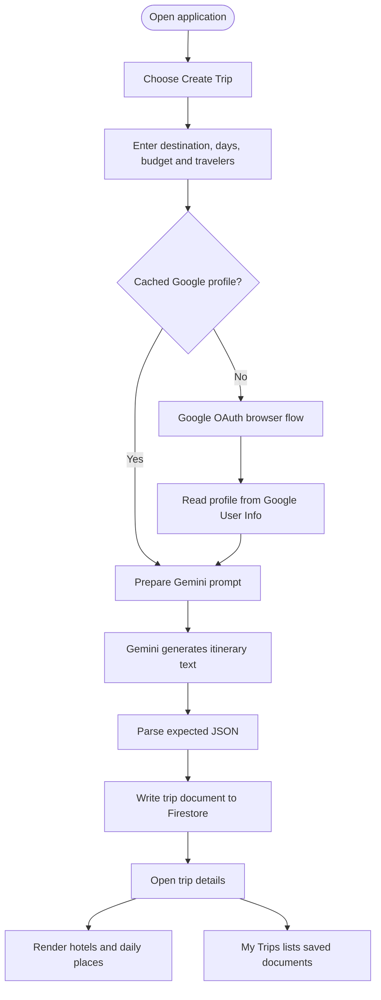
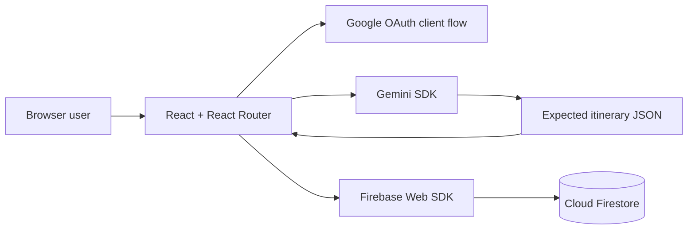

<div align="center">

# 🌍 AI Trip Planner

### ✈️ Turn travel preferences into a structured, AI-assisted itinerary.


**An AI-assisted travel planner built with React, Vite, Google Gemini, and Firebase Cloud Firestore.**

[📖 Documentation](docs/README.md) · [🧭 Architecture](docs/architecture.md) · [🛠️ Setup](docs/installation.md) · [🐛 Report a bug](https://github.com/Brajesh31/AiTripPlanner/issues/new?template=bug_report.md) · [💡 Request a feature](https://github.com/Brajesh31/AiTripPlanner/issues/new?template=feature_request.md)

</div>

---

## 🗺️ Overview

AI Trip Planner turns trip preferences into a proposed itinerary. The current app collects a destination, trip duration, budget category, and traveler category. It uses a Google OAuth browser flow, sends a prompt to the Gemini SDK, parses the response as JSON, and stores the generated trip in Cloud Firestore.

This is a **planning and suggestion interface**, not a booking or travel-verification service.

> ⚠️ **Travel accuracy notice:** AI-generated accommodations, places, addresses, prices, ratings, images, hours, routes, ticket costs, and safety details can be incorrect or stale. Verify important details with official providers before spending money or travelling.

## ✨ Current capabilities

| Area | What is implemented |
|---|---|
| Landing experience | React landing page and navigation |
| Preference collection | Destination, day count, budget, traveler category |
| Google sign-in | Browser OAuth flow using `@react-oauth/google` |
| AI generation | Gemini SDK prompt request from browser code |
| Trip persistence | Firestore documents in the `AITrips` collection |
| Saved trips | Query by profile email currently cached in localStorage |
| Trip details | Load one trip document by route ID |
| Itinerary display | Hotel suggestions and day-wise place cards |
| Hosting support | Vite build and Vercel SPA rewrite configuration |

**Not implemented as completed features:** reservations, payments, live flight/hotel availability, verified route optimization, a first-party backend, or trusted server-side authorization.

## 🧭 User journey



## 🏗️ Current system shape



The browser calls Gemini and Firestore directly. This is a security constraint, not a recommended final architecture. Review [Security](docs/security.md) before using real user data.

## 🧰 Technology stack

| Layer | Technology |
|---|---|
| UI | React 18, JSX |
| Development/build | Vite 5 |
| Routing | React Router DOM 6 |
| Styling | Tailwind CSS 3, project CSS |
| UI primitives | Radix UI |
| AI integration | `@google/generative-ai`, configured for Gemini 1.5 Flash |
| Sign-in flow | `@react-oauth/google` |
| Persistence | Firebase Cloud Firestore |
| HTTP | Axios |
| Icons/feedback | Lucide React, React Icons, React Hot Toast |
| Hosting configuration | Vercel SPA rewrite |

See [Technology Decisions](docs/technology-decisions.md) for trade-offs.

## 🚀 Run locally

### Prerequisites

- Git, Node.js 20, and npm.
- Google OAuth browser client configuration.
- Firebase project with Firestore configured.
- A restricted Gemini development key for local experimentation.

### 1. Clone and install

```bash
git clone https://github.com/Brajesh31/AiTripPlanner.git
cd AiTripPlanner
npm ci
```

### 2. Configure local environment

**macOS / Linux**
```bash
cp .env.example .env
```

**Windows PowerShell**
```powershell
Copy-Item .env.example .env
```

Set values in `.env`:

```dotenv
VITE_GOOGLE_AUTH_CLIENT_ID=your-browser-oauth-client-id
VITE_GOOGLE_GEMINI_AI_API_KEY=your-restricted-development-key
VITE_GOOGLE_PLACES_API_KEY=your-restricted-browser-key
```

**Security warning:** Vite exposes every `VITE_*` variable in client-side output. Do not put a privileged secret in a Vite variable. Move AI generation behind a server-side endpoint before production. Firebase configuration is also present in the client, so Firestore Security Rules and provider restrictions are essential.

### 3. Start development

```bash
npm run dev
```

Open the local URL printed by Vite, normally `http://localhost:5173`.

### 4. Validate the production build

```bash
npm run lint
npm run build
npm run preview
```

## 📜 npm scripts

| Command | Purpose |
|---|---|
| `npm run dev` | Start Vite development server |
| `npm run lint` | Run ESLint against `src` |
| `npm run build` | Generate production output in `dist/` |
| `npm run preview` | Preview the production build locally |

CI runs dependency installation, linting, and a production build. A dedicated unit, integration, or browser automation suite was not identified in the inspected source tree.

## 🧭 Application routes

| Route | Responsibility |
|---|---|
| `/` | Landing experience |
| `/create-trip` | Collect preferences and generate suggestions |
| `/view-trip/:tripId` | Load and render a saved trip |
| `/my-trips` | List trip records matching the cached profile email |

Vercel's rewrite supports client-side routes on refresh. Other static hosts need equivalent SPA fallback behavior.

## 🗂️ Repository map

```text
AiTripPlanner/
├── .github/                     # Issue templates and Actions workflows
├── docs/                        # Engineering and operations handbook
├── public/                      # Logo and static assets
├── src/
│   ├── components/custom/       # Header and hero
│   ├── components/ui/           # Reusable UI primitives
│   ├── constants/               # Prompt and preference options
│   ├── create-trip/             # Preference and generation flow
│   ├── my-trips/                # Saved trip listing
│   ├── service/                 # Gemini and Firebase setup
│   └── view-trip/[tripId]/      # Trip detail presentation
├── .env.example
├── package.json
├── package-lock.json
├── vite.config.js
├── tailwind.config.js
└── vercel.json
```

## 🔐 Security and privacy: read before deployment

The current application is a browser-centric prototype. Material limitations observed in source:

1. **Browser-exposed Gemini key:** the client reads a `VITE_*` Gemini key. Visitors can inspect browser bundles and network traffic. Move generation to a server-side endpoint and rotate credentials that have been exposed.
2. **Client-side profile cache:** a Google profile is stored in localStorage. Users can modify this value, so it is not proof of identity.
3. **Firestore ownership:** current reads and writes use a cached email field. A client-supplied email must not be treated as an authorization boundary.
4. **Firebase configuration:** Firebase web configuration is present in source. It is not a substitute for least-privilege Firestore Security Rules.
5. **AI output parsing:** generated text is parsed as JSON. Parsing does not validate shape, types, bounds, or content.
6. **Logging:** review console output and remove personal data or tokens from production logs.
7. **Travel decisions:** generated recommendations are not verified facts.

No server-side authorization layer or Firestore rules file was identified in the inspected tree. Do not use sensitive personal data until identity and database access rules are designed and tested.

Read [Security](docs/security.md), [Authentication](docs/authentication.md), [Firestore Data Model](docs/firestore-data-model.md), [Privacy](docs/privacy.md), and [AI Output Contract](docs/ai-output-contract.md).

## 🧪 Quality checks

```bash
npm ci
npm run lint
npm run build
```

Before release, test OAuth success/cancel/error, missing fields, malformed AI output, Firestore permission denial, empty saved-trip state, invalid trip ID, slow network, mobile layouts, keyboard navigation, and direct route refresh. See [Testing](docs/testing.md).

## 📚 Documentation library

Start at **[📖 Documentation Index](docs/README.md)**.

| Guide | Purpose |
|---|---|
| [Installation](docs/installation.md) | Local setup |
| [Architecture](docs/architecture.md) | Components, routes, and data flow |
| [Development](docs/development.md) | Contributor workflow |
| [API and Services](docs/api.md) | External service integration |
| [AI Generation](docs/ai-generation.md) | Prompt execution and model behavior |
| [AI Output Contract](docs/ai-output-contract.md) | Expected structure and validation needs |
| [Database](docs/database.md) | Firestore usage |
| [Firestore Data Model](docs/firestore-data-model.md) | Record shape and ownership concerns |
| [Authentication](docs/authentication.md) | OAuth flow and trust boundaries |
| [Environment](docs/environment.md) | Local configuration |
| [Security](docs/security.md) | Threats and mitigations |
| [Privacy](docs/privacy.md) | Data handling |
| [Accessibility](docs/accessibility.md) | Inclusive UI practices |
| [Performance](docs/performance.md) | Bundle/runtime considerations |
| [Testing](docs/testing.md) | Validation strategy |
| [Deployment](docs/deployment.md) | Hosting and build output |
| [Deployment Operations](docs/deployment-operations.md) | Release and rollback |
| [Maintenance](docs/maintenance.md) | Dependency and repository upkeep |
| [Troubleshooting](docs/troubleshooting.md) | Diagnosis guide |
| [FAQ](docs/faq.md) | Common questions |
| [Technology Decisions](docs/technology-decisions.md) | Stack rationale |
| [Diagrams](docs/diagrams.md) | Mermaid architecture views |
| [Glossary](docs/glossary.md) | Shared terminology |
| [Observability](docs/observability.md) | Diagnostics and telemetry |
| [Accessibility QA](docs/accessibility-qa.md) | Manual accessibility testing |
| [Release Checklist](docs/release-checklist.md) | Release gate |

## 🛣️ Roadmap

See [ROADMAP.md](ROADMAP.md). Roadmap items are proposals, not existing functionality. Production priorities should be trusted identity, Firestore Rules, server-side AI generation, schema validation, and automated tests.

## 🤝 Contributing

Read [CONTRIBUTING.md](CONTRIBUTING.md). Contributions should explain user impact, include lint/build results, provide relevant manual checks, and update documentation.

## 📄 License

Distributed under the [MIT License](LICENSE).

## 👨‍💻 Maintainer

**Brajesh Kumar** · [GitHub @Brajesh31](https://github.com/Brajesh31)

---

<div align="center">

**Plan thoughtfully. Verify independently. Travel responsibly. 🌏**

</div>
