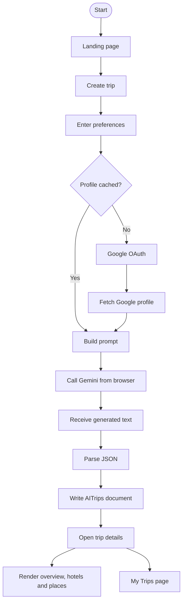
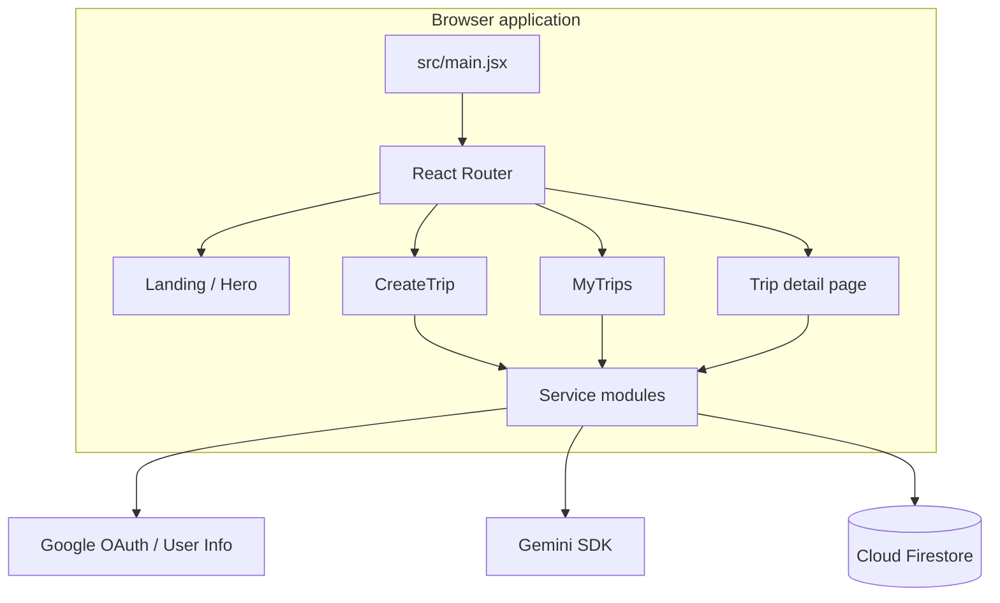
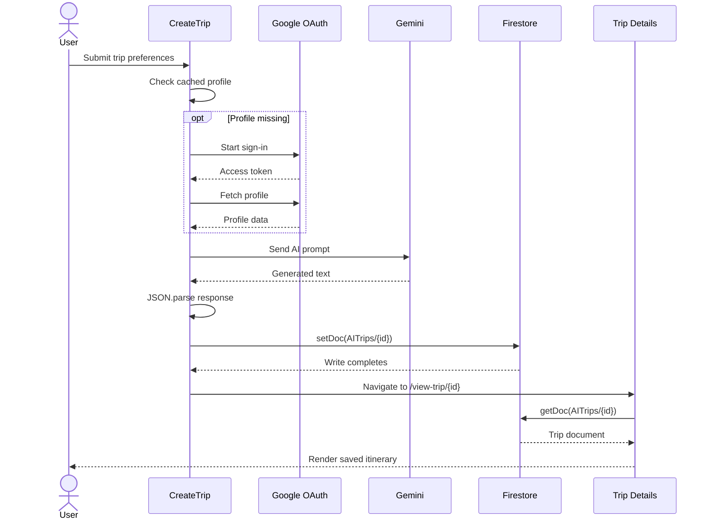
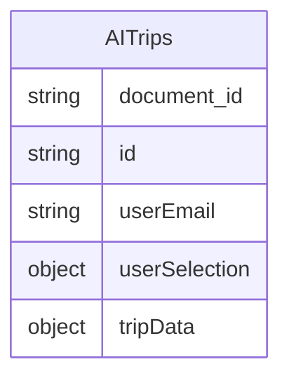
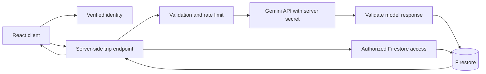
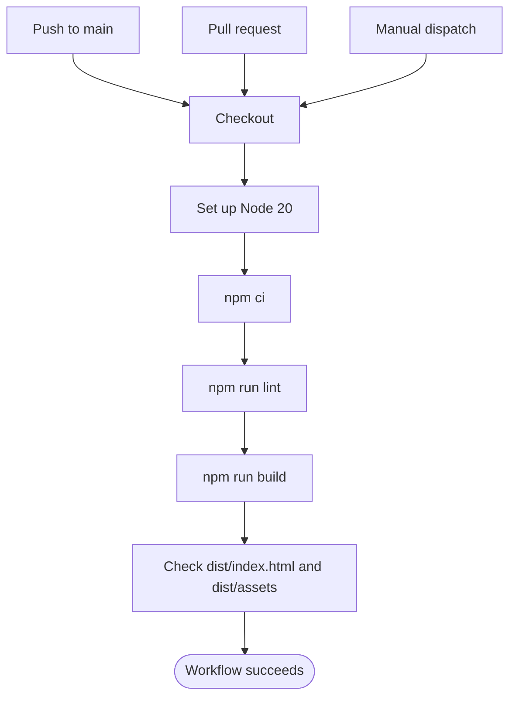
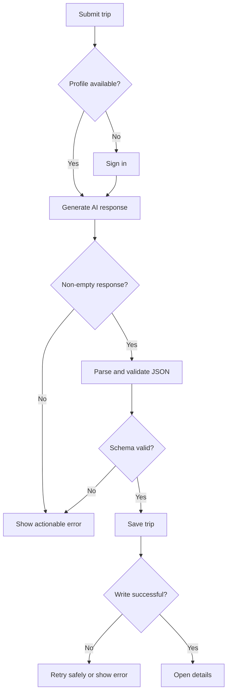

# 🗺️ Architecture and Product Diagrams

These diagrams describe checked-in implementation unless marked **Proposed**. Update them when routes, data records, or service boundaries change.

## 1. User journey

## 2. Current component and service map

## 3. Current trip data lifecycle

## 4. Current Firestore record shape

This reflects fields written by the client. It does **not** mean `userEmail` securely enforces ownership.

## 5. Proposed trusted request boundary

## 6. CI workflow

## 7. Generation failure and recovery path

The explicit error and validation nodes are recommended behavior. They are not all implemented in the current source.

## Diagram maintenance

- Label proposed architecture as proposed.
- Do not draw integrations absent from source.
- Keep route labels synchronized with React Router.
- Align data fields with the Firestore write shape.
- Never put secrets, personal data, or real trip records in diagrams.
