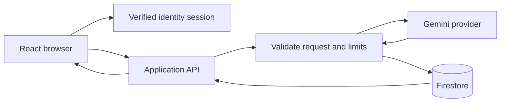

# 🧰 Technology Decisions and Trade-offs

This document records choices visible in the current source and their consequences. It is descriptive, not a claim that every choice is ideal for production.

## Decision summary

| Area | Current choice | Fit | Cost / limitation |
|---|---|---|---|
| UI | React 18 + JSX | Reusable forms and route pages | Client-side rendering requires SPA hosting |
| Build | Vite 5 | Fast development and static output | Host must serve `dist/` with route fallback |
| Routing | React Router DOM 6 | Separate create, list, and detail views | Direct route refresh needs host configuration |
| Styling | Tailwind CSS 3 | Responsive utility styling | Token consistency needs discipline |
| Model provider | Gemini SDK | Generates itinerary-shaped suggestions | Probabilistic output; current browser key is exposed |
| Identity UI | Google OAuth browser flow | Familiar sign-in experience | Cached profile is not a trusted application session |
| Persistence | Firebase Cloud Firestore | Document-oriented trip records | Rules and ownership design are critical |
| UI primitives | Radix UI | Interaction primitives | Correct labels, focus handling, and testing remain necessary |
| CI | GitHub Actions | Repeatable lint/build checks | Passing build does not prove runtime behavior |

## Architecture decision records

### ADR-001: React and Vite
**Status:** Accepted in current implementation.

React components represent the landing page, trip form, saved-trip list, and trip details. Vite supplies the development server and static production bundle.

Consequences:
- Hosting must serve `dist/`.
- Browser routes need rewrite/fallback support.
- Browser configuration must be treated as public.

### ADR-002: Firestore as the trip document store
**Status:** Accepted in current implementation.

The client writes records to `AITrips` and reads them for list and detail views.

Consequences:
- Document structure should be versioned.
- Security Rules must enforce ownership independently of client-supplied fields.
- Query patterns and indexes should be documented as they evolve.
- Deletion and retention behavior must be deliberately designed.

### ADR-003: Gemini for itinerary generation
**Status:** Accepted in current implementation; production boundary requires revision.

The browser calls the Gemini SDK with a prompt derived from form values and parses response text as JSON. Model output is untrusted. Parsing must be followed by schema validation. Provider errors, rate limits, empty output, and malformed data need explicit handling. A privileged model key must not be shipped in a browser bundle.

### ADR-004: Google OAuth profile retrieval in browser
**Status:** Existing flow; not a complete authorization design.

The client obtains a Google access token, requests profile data, and caches it in localStorage. localStorage can be changed by the user, so an email string is not a trusted record-owner credential. A production design should establish a server-verifiable identity, such as Firebase Authentication, and authorize using immutable user IDs.

## Recommended target boundaries

The hardened future architecture should separate interface, trusted API, identity, model provider, and database authorization:

This is a recommendation, not the current implementation.

## Reconsideration triggers

Revisit choices when generated content needs server-side moderation, caching, or quotas; users can share trips; generation needs abuse controls; booking/payment/live availability is introduced; data volume requires query/index tuning; or route-level automated tests become a release requirement.

## Decision change checklist

1. State the problem and supporting evidence.
2. Compare viable alternatives.
3. Record security and privacy impact.
4. Provide migration and rollback plans.
5. Explain cost and operational impact.
6. Update documentation and tests.
7. Record decision owner and date.
